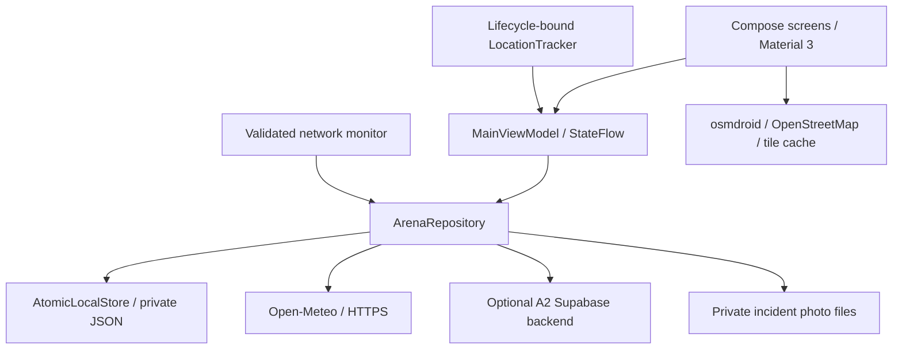

# Architecture and design

## State and data ownership

`LocalState` is the persistent source of operational data. `AtomicLocalStore` writes a complete snapshot on an IO dispatcher, under a mutex, using Android's `AtomicFile`. It publishes the new StateFlow value only after the disk write succeeds. A interrupted write retains the previous snapshot. Small event datasets make a file store suitable for P1; the assignment explicitly permits the file system. A larger product could replace `LocalStore` with Room without changing the screens.

`MainViewModel` combines the saved snapshot, network state, refresh state and transient screen state into `AppUiState`. Screens collect it with lifecycle awareness. Navigation, GPS fixes, permission messages and loading indicators are transient; shifts, task statuses, reads, demo conversations, message drafts, incident drafts, check-ins, weather and appearance are persistent. Message drafts are stored per task within the owning cached account, with a separate demo draft map. Default empty maps keep existing version-1 snapshots readable. Successful sends clear the submitted draft; failed sends and text typed during a request keep their drafts.

Each backend user has a separate cached account and outbox. A demo session uses a separate dataset. Signing out hides the operational screens; it does not delete pending updates. The backend identity must match the cached account before replaying writes.

## Offline and synchronization behavior

Task progression commits locally first. Backend sessions coalesce updates by task ID, so starting and completing a task offline queues the final status. Announcement reads are queued as a set. On reconnection, launch, return to the foreground, or manual refresh, the repository replays these idempotent writes and fetches a fresh snapshot. Failed writes stay in the outbox and remain visible. Account changes and replay are serialized to prevent a cross-account write. This is a small foreground synchronization mechanism, not a background WorkManager service.

Completed tasks can be reopened to IN_PROGRESS. Reopening uses the same assignment validation, local transaction and account-specific outbox as forward progression. If completion is undone before a sync, the final IN_PROGRESS status replaces the pending DONE status. Reopening persists across restarts and updates the progress count and Open/Done filters. The existing A2 status RPC already accepts this value; its schema is unchanged.

The cached account opens after a previously successful sign-in without requiring a new network request. A first backend sign-in needs a connection. Remote messages, QR confirmation and incident submission also need a connection; they are not queued because A2's non-idempotent message/incident RPCs do not support safe automatic replay. Failed message sends keep the saved draft; incident drafts and attached document URIs persist. Demo operations are fully local and remain available offline.

Open-Meteo is independent of volunteer login. It requests only a fixed Narvik coordinate over HTTPS. Successful weather responses are saved; failures retain the previous response. Automatic refresh is limited to once per fifteen minutes, while the explicit refresh button can request a new reading. Saved/stale readings carry their fetch time. No fictional weather is presented as live data.

OSM tiles are loaded as the user browses and cached by osmdroid. There is no bulk tile download. Unvisited imagery is unavailable offline; stored markers, place descriptions, task lists and GPS distances still work. [OSM tile policy](https://operations.osmfoundation.org/policies/tiles/).

## Location and permissions

Location is requested when the volunteer taps **Locate me**. Both precise and approximate grants are accepted. The tracker uses Android's GPS/network providers, checks device location settings, rejects old last-known fixes, listens while the map is visible, and stops on pause/disposal. A no-fix timeout, denial or disabled provider produces a useful message while task markers remain accessible.

Distances use a tested Haversine calculation and are explicitly labeled **straight-line**. The app does not promise pedestrian routes, indoor positions or travel times. GPS coordinates are held in memory and are never sent to the weather service or Supabase.

## Visual design

The visual identity uses deep fjord navy (`#0A2547`), clear blue (`#125BD4`), glacier cyan (`#8CE2F1`), pale snow backgrounds and decorative mountain silhouettes drawn in Compose. White/surface cards group actionable information. Status labels use text as well as color. Large controls, scrollable forms and five persistent navigation destinations support use while moving between volunteer locations. All cards follow the selected light/dark palette.

The Today screen prioritizes the shift, weather and next action. Tasks have useful filters and direct map/contact actions. The map separates task points from facilities. Inbox separates announcements from task conversations. The profile explains roles, work access, appearance and saved data.

## A2 continuity

The Kotlin package, Gradle wrapper, Compose/Material 3 setup, osmdroid integration, Supabase adapter/schema and QR library come from A2. P1 adds durable state, a repository around the existing backend boundary, useful failure/offline behavior, Narvik data, weather, foreground location tracking, coherent visuals, test coverage and submission documents. The P1 application ID is distinct, so it can be installed alongside A2.

Reference: [Android offline-first data layer](https://developer.android.com/topic/architecture/data-layer/offline-first).
